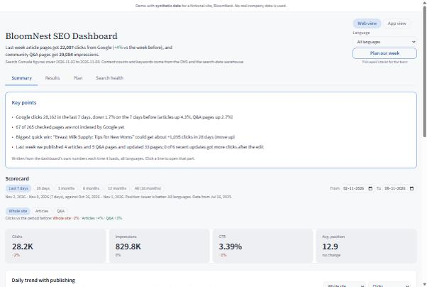
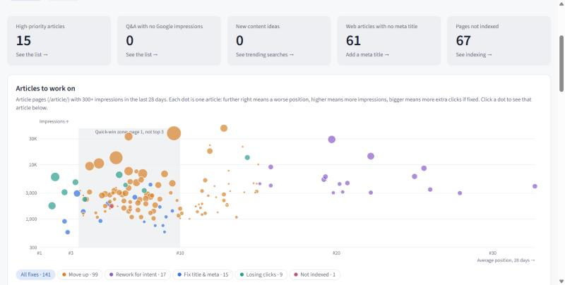
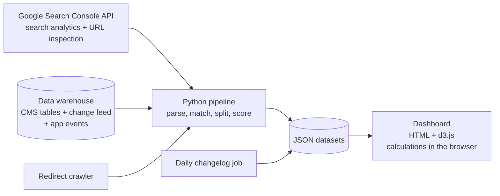

# BloomNest SEO Dashboard

A weekly SEO command centre for a content site: **what to fix this week, what last week's work achieved, and where search demand is moving**, in one page that an SEO team and managers can both read.

**Live demo: <https://sehgal08.github.io/bloomnest-seo-dashboard/dashboard/>**

> **All data in this repository is synthetic.** BloomNest is a fictional parenting site on `bloomnest.example`. The numbers, articles, searches and edits were generated by [`mock-data/generate.py`](mock-data/generate.py). The dashboard's design and logic come from a tool I built and used every week for a real parenting content platform; that company's data, names and systems are not included.



## What it answers

| Tab | Question | What's on it |
|---|---|---|
| **Summary** | How did search do, and what should I look at first? | Key points written from the numbers, a scorecard (clicks, impressions, CTR, position) for any period against the one before, the daily trend with publishing lanes, and pages gaining or losing clicks |
| **Results** | Did last week's work pay off? | What was published and updated, page-by-page search results with a *target keyword check*, "Did our updates work?" (clicks a day before vs after each edit), and a full edit history with bulk-edit and risky-edit flags |
| **Plan** | What should the team do this week? | Prioritised tasks for articles and Q&A pages, an opportunity chart, trending searches and what to do about each, plus clean-up: missing meta titles, duplicates, pages competing for the same search, and broken redirects |
| **Search health** | Are we visible and indexed? | An 8-week keyword position heat table, and Google's indexing status for new and updated pages |

Every view switches between **Web** (Google Search) and **App** (how the same articles perform inside the mobile app), and filters by language.



## The parts I'm proudest of

- **Opportunity scoring.** Each article gets *extra clicks if fixed* = impressions × (the site's typical CTR at the target position − the article's CTR now). It uses the site's own CTR curve, not an industry average, so priorities stay relative to the site. Articles are bucketed into *Fix title & meta*, *Move up*, *Losing clicks*, *Rework for intent* and *Not indexed*, each with a specific next step.
- **Recovering cut-off URLs.** Search Console truncates long URLs (common for Hindi and other non-Latin slugs once percent-encoded) at 78 characters, so several articles can collapse into one row. The pipeline matches cut keys back to full URLs by prefix, splits small groups article by article, and keeps big groups as one honest row instead of under-counting them.
- **"Did our updates work?"** For every saved edit, average daily clicks for 7 days before vs up to 7 days after, sorted worked-first. A daily job reads the CMS **change data feed** (which only keeps 7 days) to save before/after snapshots, so every meta-title, H1 and body change is kept with word counts and added or removed sections.
- **Edit risk flags.** Bulk edits (20+ pages saved in the same second), meta titles changed without their descriptions, pages that got much shorter, and articles that dropped out of in-app recommendations after an edit.
- **Trending searches to actions.** Searches whose impressions jumped are merged when they're just reordered words, filtered for off-brand terms, and turned into *Defend*, *Improve*, *Rework page* or *Create new*, based on which page ranks and where.
- **Clean-up finder.** Near-duplicate articles (word overlap of the bodies), pages competing for the same searches (with a merge-and-301 recommendation), and a redirect crawler that flags 404 endings, chains, 302s and loops.
- **Everything is traceable.** Every figure on the page is computed from a named dataset or calculation, so any number can be traced to where it came from.

## How it works



- **Weekly refresh (Mondays):** pull Search Console data (28 days, last week, the week before; page × query pairs; daily trend), inspect new and updated URLs, crawl redirects, query the CMS and app events, then rebuild the datasets. See [`pipeline/`](pipeline/).
- **Daily changelog job:** saves the last 7 days of CMS edits from the change data feed before they expire ([`pipeline/sql/changelog.sql`](pipeline/sql/changelog.sql), [`pipeline/changelog_merge.py`](pipeline/changelog_merge.py)).
- **The page** loads the datasets and does the rest in the browser: about 30 named calculations (KPIs, priorities, buckets, actions), drawn with d3.js. In this demo, [`dashboard/dash-runtime.js`](dashboard/dash-runtime.js) stands in for the host it originally ran in and reads the JSON files from [`data/`](data/).

## Run it locally

```bash
python -m http.server 8000
```
Then open <http://localhost:8000/dashboard/>.

Regenerate the fictional data, dated to the most recent Sunday:
```bash
python mock-data/generate.py
python mock-data/generate.py --seed 7   # a different but equally plausible site
```

## Repository layout

```
dashboard/        the page: index.html, style.css, part1–5.js, layout.js,
                  plus dash-runtime.js / dash-filters.js / dash-theme.css for running standalone
data/             synthetic JSON datasets (27 files)
mock-data/        the generator and its made-up vocabulary
pipeline/         the processing scripts: Search Console parsing, URL matching and splitting,
                  page × query pairs, URL inspection, redirect check, changelog merge
pipeline/sql/     change-data-feed queries for the edit history (generic table names)
tools/            check_private.py: fails if any file names the original company or its systems
docs/screenshots/ images used in this README
```

## Tech

Python 3 (standard library only), SQL (Databricks / Spark SQL, Delta change data feed), JavaScript with d3.js v7, HTML and CSS. Data sources in the original: Google Search Console API, the CMS database, mobile-app analytics events.

## My role

I designed and built this end to end: what the SEO team needed each week, the metrics and priority rules, the data pipeline and scheduled jobs, and the dashboard itself. I ran it weekly with the content team and presented it to senior management.

## About the data

Everything in `data/` is generated from random numbers with realistic shapes: clicks fall with position, weekends dip, some pages gain and some lose, edits help some pages and hurt others. Article titles and searches are generic parenting phrases written for this demo. [`tools/check_private.py`](tools/check_private.py) runs before every push and fails if any file mentions the original company or its systems.
